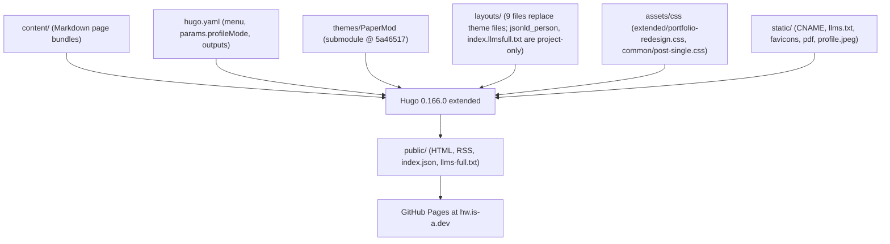

# System architecture

Static Hugo site. The PaperMod theme is a git submodule; the project replaces some theme files whole and adds extended CSS and a few custom partials.

## Content model

- `content/profile.md`, `work.md`, `speaking.md`, `publications.md`, `archives.md`, `search.md`.
- `content/talks/<YYYY>-<venue>[-n]/` and `content/certifications/<slug>/` are page bundles (`index.md` plus its cover image). Each section's `_index.md` sets `type` and `cascade`.

## Theme override layer

- Project file at a theme path replaces the theme file whole: `layouts/_default/list.html`, `single.html`, `layouts/robots.txt`, `partials/header.html`, `index_profile.html`, `share_icons.html`, `post_nav_links.html`, `extend_head.html`, and `assets/css/common/post-single.css`.
- `extend_head.html` is the theme's head hook: fonts, llms/JSON discovery links, and the `jsonld_person.html` include.
- `assets/css/extended/*.css` is concatenated after theme CSS; new CSS goes there.
- The hero kicker, gloss strip, field card and route cards are hard-coded in `layouts/partials/index_profile.html`; title, subtitle and image come from `hugo.yaml` `params.profileMode`.

## Outputs

`outputs.home` is HTML, RSS, JSON (needed by the search page) and the custom `llmsfull` format rendered from `layouts/index.llmsfull.txt`.

See [[optimization-backlog]] for the theme-version drift and override risks.
