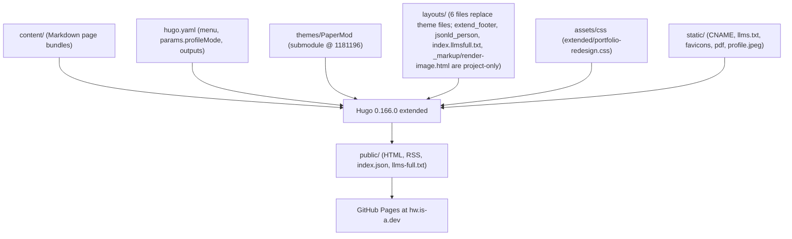

# System architecture

Static Hugo site. The PaperMod theme is a git submodule; the project replaces some theme files whole and adds extended CSS and a few custom partials.

## Content model

- `content/profile.md`, `work.md`, `speaking.md`, `publications.md`, `archives.md`, `search.md`.
- `content/talks/<YYYY>-<venue>[-n]/` and `content/certifications/<slug>/` are page bundles (`index.md` plus its cover image). Each section's `_index.md` sets `type` and `cascade`.

## Theme override layer

- Project file at a theme path replaces the theme file whole: `layouts/list.html`, `layouts/single.html`, `layouts/robots.txt`, `layouts/_partials/index_profile.html`, `post_nav_links.html`, and `extend_head.html`.
- `extend_footer.html` is the theme's footer hook; it builds the mobile menu toggle, the skip link, and the `theme-color` sync (from `--theme`) in JS so `header.html` and `baseof.html` need no override. Share-button and menu-toggle CSS live in `extended/portfolio-redesign.css`.
- `layouts/_markup/render-image.html` renders every Markdown image with lazy loading and width/height (Credly sizes from the URL, static via `images.Config`, page resources from the bundle); certification pages get a "<title> badge" alt fallback.
- `extend_head.html` is the theme's head hook: fonts, llms/JSON discovery links, and the `jsonld_person.html` include.
- `assets/css/extended/*.css` is concatenated after theme CSS; new CSS goes there.
- The hero kicker, gloss strip, field card and route cards are hard-coded in `layouts/_partials/index_profile.html`; title, subtitle and image come from `hugo.yaml` `params.profileMode`.

## Outputs

`outputs.home` is HTML, RSS, JSON (needed by the search page) and the custom `llmsfull` format rendered from `layouts/index.llmsfull.txt`.

See [[optimization-backlog]] for the optimization history.
