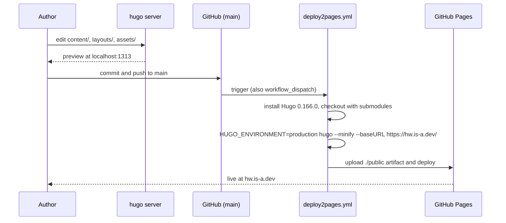

# Key flows

## Authoring to production

## Build-time rendering

- `hugo.yaml` and `content/` feed the PaperMod templates; project overrides in `layouts/` win over theme files at the same path.
- Home outputs: HTML, RSS, `index.json` (search) and `llms-full.txt`.
- `llms-full.txt` is generated from hard-coded pages and sections in `layouts/index.llmsfull.txt`; a new section must be added there and in `static/llms.txt`.

## Known defect

Talk descriptions start with `Venue: ` and the llmsfull template adds another prefix, so `llms-full.txt` shows `Venue: Venue: ...`.
