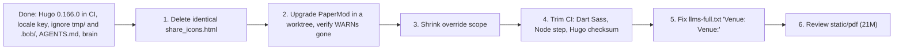

# Roadmap

> Low confidence: the repo contains no owner-stated milestones or dates. This page only reflects the optimization backlog from the 2026-11-24 review, in a suggested order with no schedule.

Details and reasoning live in [[optimization-backlog]]. Baseline tag: `pre-optimization-baseline`.
